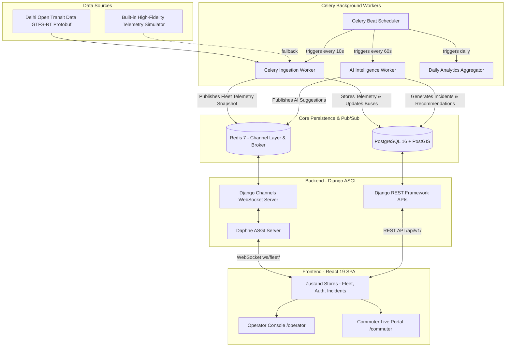

# 🚍 Smart Bus Management System (BusAI Navigator)

[](https://www.djangoproject.com/)
[](https://react.dev/)
[](https://www.typescriptlang.org/)
[](https://postgis.net/)
[](https://redis.io/)
[](https://docs.celeryq.dev/)
[](https://tailwindcss.com/)
[](https://www.docker.com/)

**BusAI Navigator** is an enterprise-grade, real-time public transit tracking and intelligent fleet dispatch management system. Designed for high-frequency metropolitan transit networks (featuring Delhi Open Transit Data integration), it unifies real-time vehicle telemetry, PostGIS spatial queries, algorithmic headway optimization, automated incident response, and dual responsive interfaces for both **Fleet Operators** and **Commuters**.

---

## 📑 Table of Contents

- [Architectural Overview](#-architectural-overview)
- [Key Features](#-key-features)
  - [Operator Command Console](#1-operator-command-console-operator)
  - [Commuter Live Portal](#2-commuter-live-portal-commuter)
  - [Algorithmic AI & Dispatch Engine](#3-algorithmic-ai--dispatch-engine)
- [System Architecture Diagram](#-system-architecture-diagram)
- [Technology Stack](#-technology-stack)
- [Repository Structure](#-repository-structure)
- [Environment Configuration](#-environment-configuration)
- [Getting Started](#-getting-started)
  - [Option A: Docker Compose (Recommended)](#option-a-docker-compose-recommended)
  - [Option B: Manual Local Setup](#option-b-manual-local-setup)
- [Delhi Transit Network Seeder](#-delhi-transit-network-seeder)
- [API Reference & Documentation](#-api-reference--documentation)
  - [REST API Endpoints](#rest-api-endpoints)
  - [Real-Time WebSocket Protocol](#real-time-websocket-protocol)
- [Legacy Codebase Note](#-legacy-codebase-note)

---

## 🏛 Architectural Overview

BusAI Navigator is engineered with a modular, asynchronous architecture designed to handle thousands of live telemetry updates concurrently:

- **Asynchronous Ingestion & Task Scheduling**: Celery workers paired with Celery Beat continuously pull and parse GTFS-RT (Protocol Buffers) vehicle feeds from the Delhi Open Transit Data portal, calculating instantaneous speeds, bearing, and delay profiles. When offline or without active API keys, a high-fidelity simulated telemetry engine smoothly steps vehicles through realistic Delhi transit corridors.
- **Geospatial Intelligence via PostGIS**: Spatial indexing and spatial operations (`ST_DWithin`, `SnapToGrid`, `ST_Distance`) power nearby stop queries, grid-based coverage deficit detection, and nearest-available vehicle searches for emergency rerouting.
- **Low-Latency Streaming via Django Channels & Daphne**: Telemetry updates, AI incident alerts, and fleet analytics rollups are published via Redis pub/sub and broadcast to connected operator and commuter clients over ASGI WebSockets.
- **Modern Single Page Application (SPA)**: Built with React 19, TypeScript, Tailwind CSS v4, Zustand state management, and React-Leaflet for smooth vector maps and responsive interactions.

---

## ✨ Key Features

### 1. Operator Command Console (`/operator`)
- **Interactive Fleet Radar**: Real-time Leaflet map displaying active buses across transit corridors with color-coded delay indicators, live headings, and speed metrics.
- **Fleet KPI Metrics**: Instant visibility into total fleet in feed, active buses on route, average network delay, and WebSocket connection health.
- **Delay Analytics & Distribution**: Live charts powered by Recharts showing delay histograms and route-level metrics.
- **AI Incident Center**: Real-time alert feed detecting stuck buses, headway gaps, and coverage deficits.
- **One-Click Incident Dispatch**: Operators can instantly resolve alerts or trigger automated rerouting of nearby candidate buses with a single click.
- **Role-Based Security**: Protected route accessible exclusively to authenticated users with `operator` or `admin` roles, verified via an operator registration passcode.

### 2. Commuter Live Portal (`/commuter`)
- **Live Vehicle & Route Visualization**: Smoothly tracking buses moving along designated route polylines.
- **Unified Transit Search**: Search by Route Number / Name (e.g., *534*, *Ring Road Mudrika*), Stop Name (e.g., *Anand Vihar*, *AIIMS*), or Bus Registration ID.
- **Stop Details & Live Arrivals**: Select any stop on the network to view incoming buses and accurate estimated times of arrival (ETAs).
- **Nearby Stops Discovery**: PostGIS-powered geospatial search finding stops within walking distance of the commuter's location.
- **Point-to-Point Journey Planner**: Search an origin and destination stop to calculate direct route connections and transfer suggestions.
- **Favorite Routes**: Commuters can bookmark frequently used routes for one-click access and quick filtering.
- **Guest Mode & Commuter Accounts**: Fully usable as a guest, with optional commuter account registration for cross-device bookmark synchronization.

### 3. Algorithmic AI & Dispatch Engine
Located in `apps.intelligence`, the dispatch engine continuously analyzes fleet dynamics:
- **Stuck Bus Detector (`stuck_detector.py`)**: Identifies buses that have remained stationary (< 1.0 km/h) for longer than 3 minutes along active corridors, flagging potential mechanical failures or acute traffic blocks.
- **EWMA Headway Analyzer (`headway_analyzer.py`)**: Uses Exponential Weighted Moving Average (EWMA, $\alpha = 0.5$) smoothing to monitor bus dispatch intervals, catching bus bunching and headway collapse before passengers experience extended wait times.
- **Spatial Coverage Grid (`coverage_grid.py`)**: Groups active bus positions into ~4.4 km PostGIS grid cells (`SnapToGrid`) to identify spatial transit deserts and coverage deficits across metropolitan sectors.
- **Spatial Divert Optimizer (`divert_optimizer.py`)**: When an incident or service interruption occurs, runs `ST_DWithin` and `ST_Distance` queries within a 2,000-meter radius to find the best low-delay, non-conflicting active bus to rescue the disrupted corridor.

---

## 📊 System Architecture Diagram



---

## 🛠️ Technology Stack

| Layer | Technologies |
|---|---|
| **Backend Framework** | Python 3.11+, Django 5.1, Django REST Framework (DRF) |
| **Real-Time Communication** | Django Channels 4.1, Redis Channel Layer, Daphne ASGI Server |
| **Asynchronous & Scheduled Tasks** | Celery 5.4, Celery Beat, django-celery-beat, django-celery-results |
| **Geospatial & Persistence** | PostgreSQL 16, PostGIS 3.4, GeoDjango |
| **External Transit Data** | GTFS-RT Protobuf (`gtfs-realtime-bindings`, `protobuf`), `httpx` |
| **Authentication & Security** | JWT Authentication (`djangorestframework-simplejwt`), Role-Based Permissions |
| **API Documentation** | OpenAPI 3, Swagger UI & ReDoc (`drf-spectacular`) |
| **Frontend Framework** | React 19, TypeScript 5, Vite 8 |
| **Frontend State & Router** | Zustand, React Router DOM v7, Axios |
| **Mapping & Visuals** | Leaflet 1.9, React-Leaflet 5, Recharts 3, Lucide React Icons |
| **Styling & Tooling** | Tailwind CSS v4, Oxlint |
| **Containers & Tooling** | Docker, Docker Compose, Git |

---

## 📂 Repository Structure

```text
smart-bus-management-system/
├── backend/
│   ├── apps/
│   │   ├── accounts/          # User authentication, roles, profile & favorites
│   │   ├── analytics/         # Route performance rollups & OTP metrics
│   │   ├── fleet/             # Bus telemetry, GTFS-RT ingestion, WebSockets
│   │   │   ├── services/      # Protobuf parsing & simulated fallback
│   │   │   ├── consumers.py   # ASGI Fleet WebSocket consumer
│   │   │   └── tasks.py       # Celery telemetry broadcast task
│   │   ├── intelligence/      # AI dispatch engine & incident management
│   │   │   ├── services/      # Stuck detector, headway analyzer, divert optimizer
│   │   │   └── tasks.py       # Celery recurring AI analytics task
│   │   └── transit/           # Routes, Stops, RouteStops sequence models & routing
│   │       ├── management/    # seed_delhi_network management command
│   │       └── services/      # Transit network seeder service
│   ├── core/
│   │   ├── asgi.py            # ASGI router for HTTP & WebSockets
│   │   ├── settings/          # Base, Development, and Production settings
│   │   └── urls.py            # API routing & OpenAPI schema endpoints
│   ├── requirements/          # base.txt, dev.txt, prod.txt
│   ├── build.sh               # Production build script (Render)
│   ├── Dockerfile             # Development container definition
│   ├── Dockerfile.prod        # Production container definition
│   └── manage.py
├── frontend/
│   ├── src/
│   │   ├── components/        # Navbar, ProtectedRoute
│   │   ├── features/
│   │   │   ├── auth/          # LoginPage, RegisterPage
│   │   │   ├── commuter/      # CommuterDashboard, JourneyPlanner, SearchBar
│   │   │   └── operator/      # OperatorDashboard, LiveMapPanel, DelayBarChart
│   │   ├── hooks/             # useWebSocket
│   │   ├── services/          # Axios API client & transit endpoints
│   │   ├── store/             # Zustand stores (fleet, auth, incident)
│   │   └── types/             # TypeScript definitions
│   ├── package.json
│   ├── tailwind.config.js
│   ├── vite.config.ts
│   └── vercel.json            # Vercel SPA routing rewrite
├── docker-compose.yml         # Multi-container orchestration (DB, Redis, Backend, Celery)
├── render.yaml                # Render Blueprint deployment definition
└── README.md
```

---

## ⚙️ Environment Configuration

Create a `.env` file in the `backend/` directory or at the root of the project. A template is provided in `.env.example`:

```ini
# ==========================================
# BusAI Navigator - Environment Configuration
# ==========================================

# Django Settings
DJANGO_SECRET_KEY=dev-secret-key-change-in-production-only-for-local-dev
DEBUG=True
ALLOWED_HOSTS=localhost,127.0.0.1,0.0.0.0

# Database (PostgreSQL + PostGIS)
DB_NAME=busai_navigator
DB_USER=busai_user
DB_PASSWORD=busai_password
DB_HOST=localhost
DB_PORT=5432

# Redis & Channels & Celery
REDIS_HOST=localhost
REDIS_PORT=6379
REDIS_URL=redis://localhost:6379/0

# Delhi Open Transit Data (OTD) GTFS-RT Feed
DELHI_GTFS_PB_URL=https://opendata.delhi.gov.in/api/realtime/VehiclePositions.pb
DELHI_GTFS_API_KEY=your_delhi_otd_api_key_here
BUS_LIMIT=200

# Operator Verification
OPERATOR_SECRET_KEY=OPERATOR2026

# CORS Configuration
CORS_ALLOWED_ORIGINS=http://localhost:5173,http://127.0.0.1:5173
```

For the frontend, configure `frontend/.env` (or `frontend/.env.production`):

```ini
VITE_API_BASE=http://localhost:8000/api/v1
```

---

## 🚀 Getting Started

### Option A: Docker Compose (Recommended)

Docker Compose starts all required services: PostGIS database, Redis cache, Daphne ASGI backend, Celery worker, and Celery beat scheduler.

1. **Clone the Repository**:
   ```bash
   git clone https://github.com/anandbandgar004/smart-bus-management-system.git
   cd smart-bus-management-system
   ```

2. **Launch Containers**:
   ```bash
   docker-compose up --build
   ```

3. **Initialize Database & Seed Network**:
   In a new terminal window:
   ```bash
   docker-compose exec backend python manage.py migrate
   docker-compose exec backend python manage.py seed_delhi_network
   docker-compose exec backend python manage.py createsuperuser
   ```

4. **Start the Frontend**:
   ```bash
   cd frontend
   npm install
   npm run dev
   ```

5. Open [http://localhost:5173](http://localhost:5173) in your browser.

---

### Option B: Manual Local Setup

#### 1. Backend Setup

Prerequisites: Python 3.11+, PostgreSQL with PostGIS extension, and Redis server running.

```bash
# Navigate to backend
cd backend

# Create and activate virtual environment
python -m venv venv
# On Windows:
.\venv\Scripts\activate
# On Linux/macOS:
source venv/bin/activate

# Install dependencies
pip install -r requirements/base.txt

# Run migrations
python manage.py migrate

# Seed Delhi network routes and stops
python manage.py seed_delhi_network

# (Optional) Create superuser
python manage.py createsuperuser

# Start Daphne ASGI server
daphne -b 0.0.0.0 -p 8000 core.asgi:application
```

In separate terminals (with virtualenv activated):

```bash
# Terminal 2: Run Celery Worker
celery -A core worker -l info

# Terminal 3: Run Celery Beat Scheduler
celery -A core beat -l info --scheduler django_celery_beat.schedulers:DatabaseScheduler
```

#### 2. Frontend Setup

Prerequisites: Node.js 18+ and npm.

```bash
cd frontend
npm install
npm run dev
```

The frontend will run on `http://localhost:5173`.

---

## 🗺 Delhi Transit Network Seeder

The system includes a pre-packaged transit seeder command that populates major Delhi transit corridors with high-precision GPS coordinates, ordered stop sequences, and route geometry:

```bash
python manage.py seed_delhi_network
```

Populated routes include:
- **DL-534**: Anand Vihar ISBT $\leftrightarrow$ Mehrauli Terminal *(via Laxmi Nagar, ITO, AIIMS, Hauz Khas)*
- **DL-729**: Mori Gate Terminal $\leftrightarrow$ Kapashera Border *(via Old Delhi, Connaught Place, Dhaula Kuan, Mahipalpur)*
- **DL-427**: Nizamuddin Railway Station $\leftrightarrow$ Badarpur Border *(via Ashram, Nehru Place, Okhla)*
- **DL-TMS**: Ring Road Mudrika Orbital Loop *(Dhaula Kuan, AIIMS, Lajpat Nagar, ISBT Kashmere Gate)*
- **DL-RL77**: New Delhi Railway Station $\leftrightarrow$ Dwarka Sector 10 *(via Patel Nagar, Janakpuri, Uttam Nagar)*
- **DL-GL23**: ISBT Kashmere Gate $\leftrightarrow$ Nehru Place Terminal *(via Red Fort, Delhi Gate, Pragati Maidan)*

---

## 📡 API Reference & Documentation

Interactive API documentation is generated automatically using OpenAPI 3.0 via `drf-spectacular`:

- **Swagger UI**: [http://localhost:8000/api/docs/](http://localhost:8000/api/docs/)
- **ReDoc**: [http://localhost:8000/api/redoc/](http://localhost:8000/api/redoc/)
- **OpenAPI Schema (JSON)**: [http://localhost:8000/api/schema/](http://localhost:8000/api/schema/)

### REST API Endpoints

| Module | Method | Endpoint | Description |
|---|---|---|---|
| **Health** | `GET` | `/healthz/` | Service health status check |
| **Auth** | `POST` | `/api/v1/accounts/register/` | Register new commuter or operator user |
| **Auth** | `POST` | `/api/v1/accounts/login/` | Obtain JWT access and refresh token pair |
| **Auth** | `POST` | `/api/v1/accounts/refresh/` | Refresh JWT access token |
| **Auth** | `GET` | `/api/v1/accounts/me/` | Fetch current authenticated user profile |
| **Auth** | `POST` | `/api/v1/accounts/favorites/toggle/` | Bookmark or remove a favorite route |
| **Transit** | `GET` | `/api/v1/transit/routes/` | List all available transit routes |
| **Transit** | `GET` | `/api/v1/transit/routes/search/?q={query}` | Search routes, stops, and vehicles |
| **Transit** | `GET` | `/api/v1/transit/routes/{id}/path/` | Retrieve route path and ordered stops |
| **Transit** | `GET` | `/api/v1/transit/stops/nearby/?lat={lat}&lng={lng}` | Find stops within walking radius |
| **Transit** | `GET` | `/api/v1/transit/stops/{id}/arrivals/` | Live estimated arrivals for a stop |
| **Transit** | `GET` | `/api/v1/transit/stops/plan-journey/` | Origin to destination journey planning |
| **Fleet** | `GET` | `/api/v1/fleet/buses/` | List active fleet vehicles and locations |
| **Intelligence** | `GET` | `/api/v1/intelligence/incidents/` | List detected fleet incidents and alerts |
| **Intelligence** | `POST` | `/api/v1/intelligence/incidents/{id}/dispatch/` | Dispatch recommended divert action |
| **Analytics** | `GET` | `/api/v1/analytics/metrics/route-history/` | Route performance and delay statistics |

### Real-Time WebSocket Protocol

- **Endpoint**: `ws://<host>:<port>/ws/fleet/`
- **Group Channel**: `fleet_updates`
- **Events Emitted**:
  - `fleet_snapshot`: Initial and periodic batch updates of active buses (IDs, coordinates, speeds, delays).
  - `ai_suggestions`: High-priority AI incident alerts with suggested divert/reroute actions.
  - `analytics_summary`: Fleet-wide summary metrics (total in feed, per-route distributions).

---

## 📦 Legacy Codebase Note

The original early prototype of this project was implemented using Node.js, Express, and static HTML files (archived in `backend_legacy/` and `frontend_legacy/`). 

The current system has been completely rewritten and re-architected into the modern production-ready stack featured in `backend/` and `frontend/`:
- Migrated from MongoDB to **PostgreSQL + PostGIS** for native spatial computing and spatial indexing.
- Migrated from Express to **Django 5.1 + Channels + Celery** for structured micro-apps, background worker pipelines, and scalable WebSockets.
- Migrated from vanilla HTML/JS to **React 19 + TypeScript + Vite + Tailwind CSS v4** for componentized modularity, typed safety, and rich state synchronization.

---

